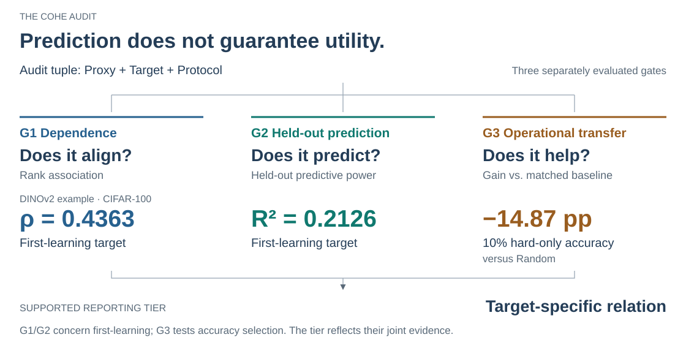
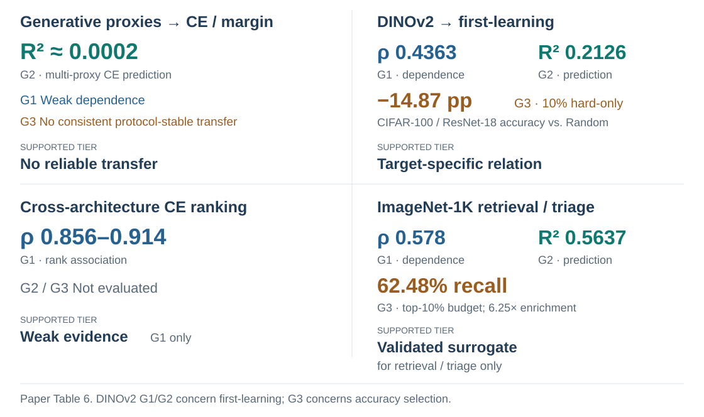
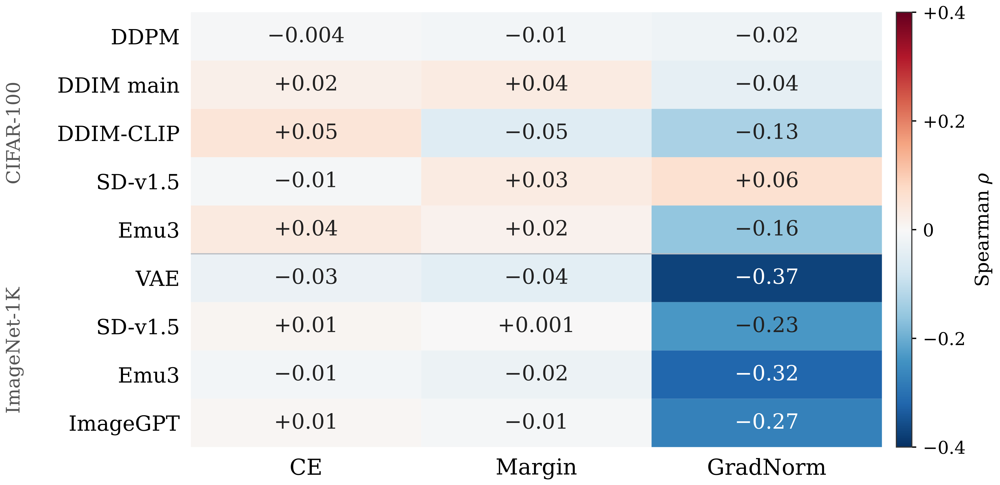
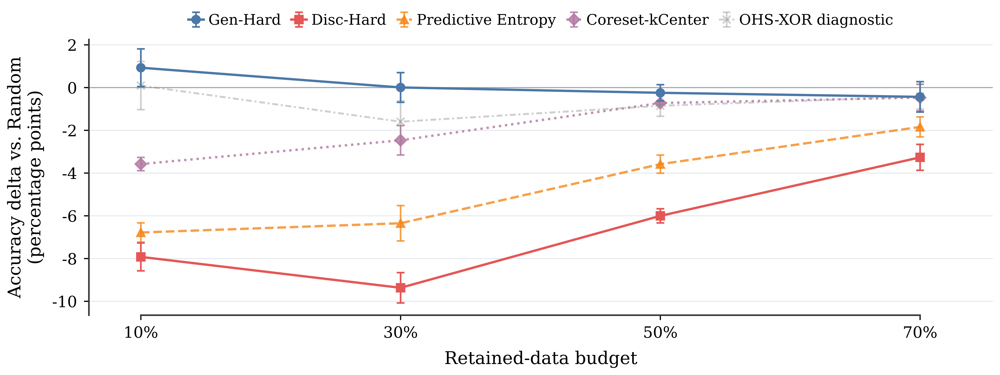

<h1 align="center">COHE</h1>
<h2 align="center">Auditing Non-Transitivity in Sample Difficulty Proxies for Vision Models</h2>

<p align="center">Dayena Jeong · Sunglok Choi</p>
<p align="center"><strong>NeurIPS 2026 · Evaluations &amp; Datasets</strong></p>

<p align="center">
  <a href="https://mint-lab.github.io/cohe/"></a>
  <a href="https://neurips.cc/virtual/2026/poster/139659"></a>
  <a href="https://github.com/DayenaJeong/cohe"></a>
  <a href="https://github.com/DayenaJeong/cohe/releases/tag/v1.0-neurips2026"></a>
  <a href="#citation-and-license"></a>
</p>

COHE (Cross-Objective Hardness Evaluation) separates ranking agreement, held-out prediction, and downstream benefit when auditing sample difficulty proxies. These forms of evidence need not imply one another.

<p align="center">
  <picture>
    <source media="(max-width: 640px)" srcset="assets/cohe-framework-mobile.svg">
    
  </picture>
</p>

[Original paper Figure 1](assets/paper/figure-1-framework.png?raw=1) · [Six reporting tiers and assignment rules](docs/CLAIM_TIER_GUIDE.md)

The gates are evaluated separately; their joint evidence supports a tier for the declared target and protocol. A G3-only pass can support **Operational-only effect**. An unmeasured gate is distinct from a failed gate.

## Key findings

Four audits show different levels of support. Each finding concerns its tested target and operational endpoint (paper Table 6).

<p align="center">
  <picture>
    <source media="(max-width: 640px)" srcset="assets/cohe-results-summary-mobile.svg">
    
  </picture>
</p>

### Dependence audit

<p align="center">
  <a href="assets/paper/figure-2c-dependence.png?raw=1"></a>
</p>

**Figure 2(c). Dependence audit.** Generative proxies have weak CE/margin alignment; larger GradNorm associations are target-specific. DDPM denotes the score norm used for Gen-Hard selection.

[Full-resolution PNG](assets/paper/figure-2c-dependence.png?raw=1) · [Vector SVG](assets/paper/figure-2c-dependence.svg?raw=1)

### Operational transfer

<p align="center">
  <a href="assets/paper/figure-4-operational-transfer.png?raw=1"></a>
</p>

**Figure 4. Operational-transfer audit.** CIFAR-100/ResNet-18 paired accuracy differences versus Random, with five seeds and 95% confidence intervals. Gen-Hard uses DDPM score norm; Disc-Hard and OHS-XOR are diagnostics.

[Full-resolution PNG](assets/paper/figure-4-operational-transfer.png?raw=1) · [Vector SVG](assets/paper/figure-4-operational-transfer.svg?raw=1)

### Results at a glance

<details>
<summary>Evidence, exact values, and supported tiers as text</summary>

| Audit setting | Evidence and supported tier |
| --- | --- |
| Generative proxies → CE/margin | **G1:** weak association. **G2:** near-zero prediction; multi-proxy CE R² ≈ 0.0002. **G3:** no protocol-stable selection gain. **Tier:** No reliable transfer. |
| DINOv2 → first-learning | **G1:** ρ = 0.4363. **G2:** R² = 0.2126. **G3:** CIFAR-100/ResNet-18 hard-only accuracy selection loses 14.87 pp versus Random at 10%. **Tier:** Target-specific relation. First-learning and selection accuracy are distinct targets. |
| Cross-architecture CE ranking | **G1:** ρ = 0.856–0.914. **G2/G3:** not evaluated. **Tier:** Weak evidence (G1 only). |
| ImageNet-1K CE retrieval/triage | **G1:** ρ = 0.578. **G2:** R² = 0.5637. **G3:** top-10% recall = 62.48%, enrichment = 6.25×. **Tier:** Validated surrogate for retrieval/triage only. The proxy is ResNet-18 CE; the target is ResNet-50 CE. |

The generative row summarizes multiple audits. G1/G2 entries describe retained evidence; a gate pass requires the declared criteria and uncertainty checks. An unmeasured gate is distinct from a failed gate. Retrieval/triage is a different endpoint from retraining accuracy.

</details>

[Quick start](#quick-start) · [Reproduction coverage](#reproduction-and-experiments) · [Data & checkpoints](#data-and-checkpoints)

## Installation

Use Python 3.10 or newer for the public CPU interface:

```bash
python -m pip install -r requirements-cpu.txt
bash scripts/smoke_test.sh
```

Training and scoring dependencies are separate. The recorded ImageNet environment is in `environment-imagenet.yml`; see [`docs/ENVIRONMENTS.md`](docs/ENVIRONMENTS.md). Historical versions are documented only where recovered from logs.

## Quick start

```bash
python scripts/reproduce.py --experiment dependence
python scripts/reproduce.py --experiment predictive_validity
python scripts/reproduce.py --experiment dinov2_gate3
python scripts/reproduce.py --experiment ddpm_ordering
python scripts/reproduce.py --experiment imagenet1k_vae_gate3
python scripts/reproduce.py --experiment paper_results
```

The first command computes a scalar DDIM/CE dependence check from released values. The second is a univariate linear interface check on released DINOv2/first-learning values, **not** a reproduction of every paper nonlinear model. The Gate 3 commands recompute paired statistics from completed experiment records; they do not retrain models. `paper_results` checks all four DINOv2 conditions, all eight ordering pairs, and both ImageNet-1K endpoints.

Toy examples in `examples/` exercise interfaces and are not experimental evidence. The claim-card script is a reporting aid; the six reporting tiers and their precedence are described in [`docs/CLAIM_TIER_GUIDE.md`](docs/CLAIM_TIER_GUIDE.md).

## Reproduction and experiments

This is the official artifact for the accepted NeurIPS 2026 paper. The fixed camera-ready source and checkpoint release is [`v1.0-neurips2026`](https://github.com/DayenaJeong/cohe/releases/tag/v1.0-neurips2026).

`v1.0-neurips2026` is the fixed scientific release snapshot; the current `main` branch includes documentation-only post-release corrections, with no changes to scientific code, reported results, or checkpoint binaries.

The repository includes the COHE audit code, recovered experiment implementations, seven CIFAR-100 scalar arrays, aggregate and seed-level results, and author-trained checkpoints for retained endpoints. Reproduction coverage varies by experiment because raw datasets, some historical inputs, and third-party pretrained weights are not redistributed.

[`docs/REPRODUCIBILITY.md`](docs/REPRODUCIBILITY.md) summarizes experiment-level coverage, required upstream inputs, and known gaps. [`docs/REPRODUCTION_MATRIX.md`](docs/REPRODUCTION_MATRIX.md) lists expected outputs and GPU entry points. The machine-readable experiment inventory is in [`provenance/release_inventory.csv`](provenance/release_inventory.csv), and [`results/SOURCE_OF_TRUTH.csv`](results/SOURCE_OF_TRUTH.csv) indexes the reported result files.

CPU commands verify released scalars and completed-result statistics. Full scoring or training requires the appropriate datasets, upstream models, inputs, environment, and compute.

## Data and checkpoints

Obtain CIFAR-10/100, Imagenette, and ImageNet-1K from their maintainers and follow their terms. No raw images or upstream archives are redistributed. CIFAR source order is the original torchvision CIFAR-100 training order. The seven released 50,000-entry arrays are DDPM, DDIM, SD-VAE, SD-v1.5, Emu3 VQ, ConvAE, and DINOv2 under `derived_scalar_arrays/cifar100/`; each has an index manifest.

Not all eight primary generative families are released as scalar arrays. ImageNet-1K scalar arrays are intentionally excluded. Target coverage is incomplete for some family/target combinations. Gate 2 covers scalar or low-dimensional inputs; it does not test full underlying representation information.

The [GitHub Release](https://github.com/DayenaJeong/cohe/releases/tag/v1.0-neurips2026) provides 234 author-trained checkpoints in nine archives. No checkpoint binary is committed to ordinary Git. See [`checkpoints/README.md`](checkpoints/README.md) for coverage, missing endpoints, manifests, and loading instructions.

Pretrained model identifiers, recovered revisions, unresolved provenance, and terms pointers are in [`provenance/UPSTREAM_ASSETS.csv`](provenance/UPSTREAM_ASSETS.csv). Users obtain these weights directly from their owners.

## Limitations

Historical CIFAR-100 source-model provenance is incomplete; Disc-Hard, Predictive Entropy, α-mix, and OHS-XOR characterize retained score-based policies rather than task-trained hardness or uncertainty in general.

Code recovery is partial for historical diagnostics, and some exact historical checkpoint tags remain unresolved. Available training code still needs upstream inputs, GPU compute, and experiment-specific environment validation. DINOv2 selection, the ResNet-50 second learner, and the ImageNet-10 fine-tuning runs have no retained endpoint weights. DDPM ordering includes 18 of 24 expected endpoints. Full regeneration is not claimed for every reported block.

The standalone shuffled-DDIM negative-control runner and cross-architecture runner are incomplete historical recoveries. Some timestep/calibration provenance remains unresolved, and the full predictive suite requires inputs not redistributed here. Completed numerical records remain available independently of checkpoint or code coverage.

## Citation and license

Citation metadata is provided in [`CITATION.cff`](CITATION.cff).

```bibtex
@inproceedings{jeong2026cohe,
  title = {COHE: Auditing Non-Transitivity in Sample Difficulty Proxies for Vision Models},
  author = {Jeong, Dayena and Choi, Sunglok},
  booktitle = {Advances in Neural Information Processing Systems},
  year = {2026},
  note = {Evaluations \& Datasets Track},
  url = {https://neurips.cc/virtual/2026/poster/139659}
}
```

This follows the project homepage citation and links to the official NeurIPS presentation record. Update it to match the final proceedings BibTeX when that record becomes available.

Author-created source code is released under the [MIT License](LICENSE). That license does not apply to or relicense third-party datasets, models, or pretrained weights. See [`LICENSE_OR_TERMS.md`](LICENSE_OR_TERMS.md) and the upstream provenance notes for scope.
